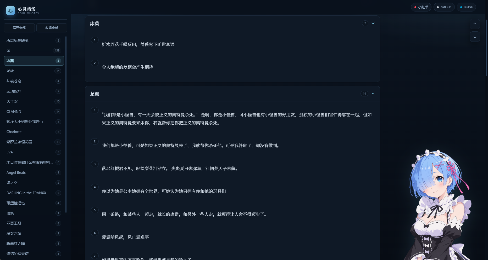
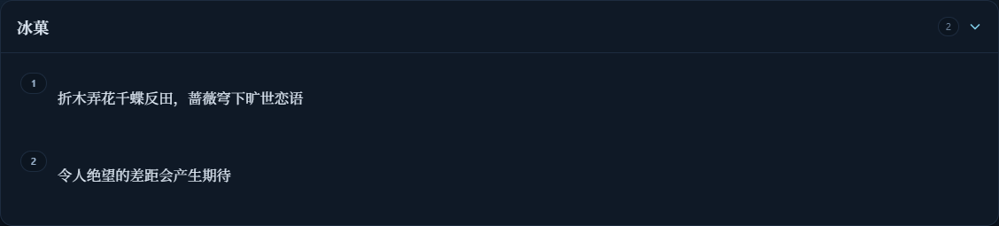

# 心灵鸡汤 · Soul Quotes Archive

一路走来阅读和看番中所深深触动的话语，希望这些话语能够带给你同样的鼓舞与激励。

## 功能特性

- **分类展示** — 按作品来源分类（冰菓、龙族、CLANNAD、紫罗兰永恒花园、EVA 等），折叠式手风琴布局
- **蕾姆深蓝单主题** — 只保留一套蕾姆配色（深海蓝底 + 蕾姆蓝高光），跟随系统深色，无浅色/纯白模式
- **侧边栏目录** — 快速导航，支持一键展开/折叠所有分类
- **响应式设计** — 适配桌面端与移动端，窄屏下侧边栏变为抽屉式菜单
- **Markdown 渲染** — 基于 marked.js 的富文本渲染，支持引用块等多行排版
- **Obsidian Callout** — 自动识别 `> [!note]` / `[!tip]` / `[!warning]` 等语法，渲染为带图标与配色的提示卡片
- **界面风格** — 参考 GitHub Primer 的卡片、间距与控件体系，配色取蕾姆（Re:Zero）蓝，首屏搭配接近原作动画画风的蕾姆半身插画（本地透明 PNG，无外部图片请求）

## 技术栈

纯静态站点，零构建依赖：

- **HTML5 + CSS3 + Vanilla JavaScript** — 单文件 SPA（`index.html`）
- **[marked.js](https://marked.js.org/)** — Markdown 渲染（本地 `marked.min.js`，离线可用）
- **Noto Serif SC** — Google Fonts 中文衬线字体（无网络时回退系统字体）
- 内容与展示分离 — 每次打开或刷新网页，直接请求同目录的 `心灵鸡汤.md`，禁用浏览器请求缓存，无需构建或内嵌正文

## 项目结构

```
soul_quotes_archive/
├── index.html          # 前端应用，每次加载时读取 Markdown
├── assets/rem-hero.png # 首页蕾姆透明插画
├── marked.min.js       # 本地 Markdown 解析器，离线可用
├── 心灵鸡汤.md          # 语录内容库（唯一的编辑入口）
├── 打开网页.cmd         # Windows 双击打开本地网页
├── serve.py            # Python 标准库本地预览服务
├── build.py            # 兼容旧命令，转为启动本地预览
├── .nojekyll           # GitHub Pages 直接发布静态文件
└── README.md
```

## 本地运行

安装 Python 3 后，双击 **`打开网页.cmd`**，浏览器会自动打开本地网页。保持命令窗口开启，修改 `心灵鸡汤.md` 后刷新页面即可看到最新内容。

也可以在项目目录运行：

```bash
python serve.py
```

直接双击 `index.html` 使用的是 `file://`，浏览器无法自动读取旁边的 Markdown 文件；页面会提示使用启动文件，不会显示过期正文。无需更换 HTML 后缀，也不需要运行构建命令。

## GitHub Pages 发布与更新

仓库 **Settings → Pages** 选择 **Deploy from a branch**，选定存放本项目的发布分支和 **`/(root)`** 目录。已有 Pages 配置可继续使用。

首次提交需要包含 `index.html`、`marked.min.js`、`心灵鸡汤.md`、`assets/` 和 `.nojekyll`。`.nojekyll` 让 Pages 直接发布原始静态文件，保留 Markdown 文件供页面读取。

以后只修改并提交 `心灵鸡汤.md` 到发布分支即可；等 GitHub Pages 部署完成，再打开或刷新网页。页面会重新请求已部署的 Markdown，不需要再同步 HTML。尚未提交的本地修改不会出现在在线网页。

## 在线访问

- **主站：** [sakuraloveforever.github.io/soul_quotes_archive](https://sakuraloveforever.github.io/soul_quotes_archive/)

## 效果预览

整体布局：

[](https://raw.githubusercontent.com/SakuraLoveForever/soul_quotes_archive/main/assets/preview.png)

语录卡片细节（从原图裁切，保留原始像素）：

[](https://raw.githubusercontent.com/SakuraLoveForever/soul_quotes_archive/main/assets/preview-detail.png)

点击图片可查看原图，也可以直接访问[在线网页](https://sakuraloveforever.github.io/soul_quotes_archive/)体验。

## Star History

<a href="https://www.star-history.com/?repos=SakuraLoveForever%2Fsoul_quotes_archive&type=date&legend=top-left">
 <picture>
   <source media="(prefers-color-scheme: dark)" srcset="https://api.star-history.com/chart?repos=SakuraLoveForever/soul_quotes_archive&type=date&theme=dark&legend=top-left" />
   <source media="(prefers-color-scheme: light)" srcset="https://api.star-history.com/chart?repos=SakuraLoveForever/soul_quotes_archive&type=date&legend=top-left" />
   
 </picture>
</a>
